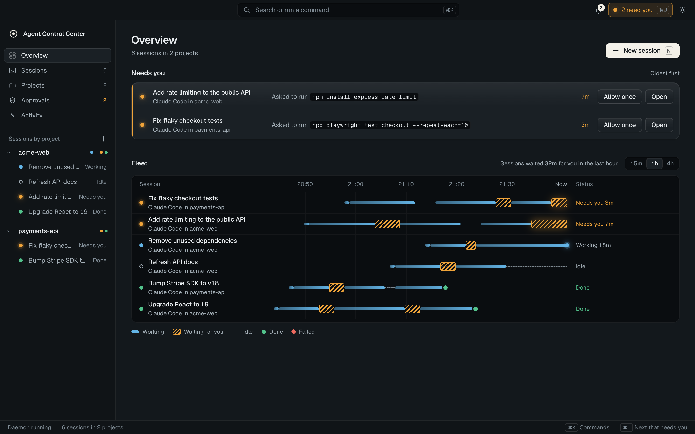
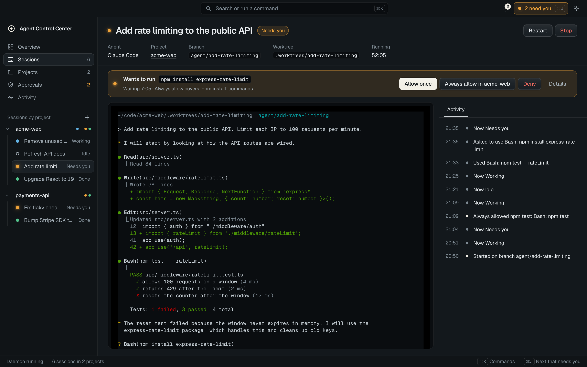
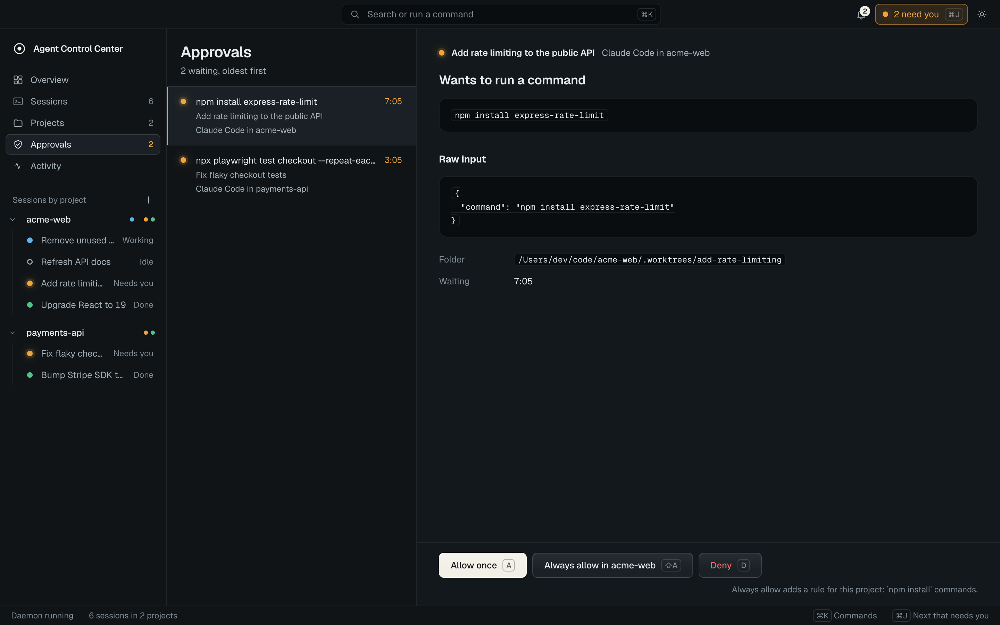

<p align="center"></p>

# Agent Control Center

A free, open-source desktop app to run and supervise AI coding agents like Claude Code on macOS, Linux and Windows.




## What it does

Agent Control Center runs several Claude Code sessions in one window. Each session is a real coding agent in its own terminal and its own git worktree, owned by a small local daemon, so it keeps running when you close the window. Permission requests from all sessions land in one approvals inbox.

## Features

- Each session runs in its own git worktree and `agent/<slug>` branch, so your checkout is untouched.
- Sessions keep running when the window closes. Reopen the app and reattach.
- A live terminal for each session, in the real Claude Code UI.
- One approvals inbox with Allow once, Always allow and Deny.
- "Always allow" never covers secrets files or risky commands.
- An overview of all sessions and an activity log of every approval and event.
- A command palette (Cmd+K, or Ctrl+K on Linux and Windows) and keyboard shortcuts.
- A soft chime when a session needs you.

## Screenshots



A session with its live terminal, activity log and a permission request waiting.



The approvals inbox, with the command the agent wants to run.

Screenshots use demo data.

## Download and install

Open the [latest release](../../releases/latest) and download the file for your system. The builds are unsigned.

### macOS

1. Download the `.dmg` for your Mac: `aarch64` for Apple Silicon, `x64` for Intel.
2. Open the `.dmg` and drag the app to Applications.

On first open, right-click the app and choose Open, or remove the quarantine flag:

```
xattr -dr com.apple.quarantine "/Applications/Agent Control Center.app"
```

### Linux

The Linux builds are for x86_64. Linux support is new, so please [open an issue](../../issues/new/choose) if something does not work.

- AppImage, for any distribution: make it executable, then run it.

  ```
  chmod +x <file>.AppImage
  ./<file>.AppImage
  ```

  If it says it needs FUSE, install FUSE 2: `sudo apt install libfuse2` on Ubuntu 22.04, `libfuse2t64` on 24.04 and later.
- `.deb`, for Debian and Ubuntu. It installs the app and what it needs:

  ```
  sudo apt install ./<file>.deb
  ```

- `.rpm`, for Fedora: `sudo dnf install ./<file>.rpm`.

### Windows

The Windows builds are for x64. Windows support is new, so please [open an issue](../../issues/new/choose) if something does not work.

1. Download the `.msi` or the `-setup.exe`. Either one installs the app.
2. Open it. The builds are unsigned, so SmartScreen says "Windows protected your PC". Choose More info, then Run anyway.

## Requirements

- macOS 13 or later (Apple Silicon or Intel), Linux on x86_64 with glibc 2.35 or later, such as Ubuntu 22.04, Debian 12, Fedora 36 or newer, or Windows 10 or 11 (x64).
- [Claude Code](https://docs.claude.com/en/docs/claude-code) installed and signed in, 2.1.139 or later on Windows. `claude` must work in a terminal.
- git. On Windows, [Git for Windows](https://git-scm.com/downloads/win).

## Quick start

1. Open the app and add a project: pick a git repository.
2. Start a session (press `n`), pick the project and describe the task.
3. When the agent asks for permission, open Approvals, read what it wants to run, then allow once, always allow or deny.

## Keyboard shortcuts

| Key | Action |
|-----|--------|
| `Cmd+K` (`Ctrl+K` on Linux and Windows) | Open the command palette |
| `Cmd+J` (macOS only) | Jump to the next session that needs you |
| `n` | New session |
| `g` then `o`, `s`, `i`, `p`, `a` | Go to Overview, Sessions, Approvals, Projects, Activity |

On Linux and Windows, `Ctrl+J` is a newline in the session terminal, so the jump has no key there. Use the "needs you" button in the title bar.

## Platforms

macOS 13+, Linux (x86_64) and Windows 10 and 11 (x64). Contributions are welcome.

## Build from source

You need Rust stable, Node 23 and git. On Linux you also need the Tauri system packages, and on Windows the Visual Studio C++ build tools, listed in [CONTRIBUTING.md](CONTRIBUTING.md).

```
npm ci
npm run tauri dev
```

On a fresh clone, run `npm run sidecars` before `cargo build` or `cargo test`. See [CONTRIBUTING.md](CONTRIBUTING.md) for tests and the full workflow.

## Safety and privacy

- Permission requests from Claude Code wait for your decision in the inbox. If the daemon cannot be reached, the request is denied.
- "Always allow" is conservative and shows what a rule covers before you choose it.
- Everything stays on your machine: no telemetry, no account, no network calls of its own. Claude Code itself talks to Anthropic as usual.
- The daemon socket has no authentication yet. It is limited to your user (mode 0600, or a named pipe only your user can open on Windows).

The full rules, protected paths, data locations, keyboard shortcuts and known limitations are in [docs/safety.md](docs/safety.md).

## Links

- [How it works](docs/architecture.md)
- [Roadmap](docs/roadmap.md)
- [Contributing](CONTRIBUTING.md)
- [Security](SECURITY.md)
- [Changelog](CHANGELOG.md)
- [License](LICENSE) (MIT)

Agent Control Center is an independent open-source project and is not affiliated with or endorsed by Anthropic. Claude and Claude Code are trademarks of Anthropic.
