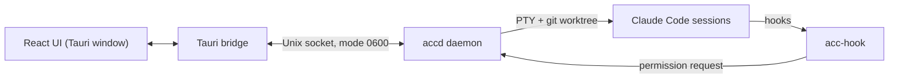

# How it works

This page shows how the Agent Control Center parts fit together.

- `accd` is a Rust daemon. It starts the Claude Code processes in pseudo-terminals, one git worktree each, and stores projects, sessions, approvals, rules and the event log in SQLite.
- `acc-hook` is the small binary Claude Code calls for its hooks. It forwards each hook to `accd` and prints the permission reply. If it cannot reach the daemon, the request is denied.
- The app is a Tauri 2 + React client. It talks to `accd` through the Tauri bridge over a Unix socket. There are no TCP ports.

The app starts `accd` if none is running, detached, so it outlives the window.
