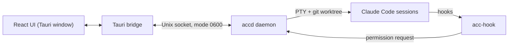

# Safety, privacy and details

This page has the full rules behind Agent Control Center: how approvals work, what "Always allow" covers, where data lives, keyboard shortcuts and known limitations. The [README](../README.md) has the short version.

## How it works



- `accd` is a Rust daemon. It starts the Claude Code processes in pseudo-terminals, one git worktree each, and stores projects, sessions, approvals, rules and the event log in SQLite.
- `acc-hook` is the small binary Claude Code calls for its hooks. It forwards each hook to `accd` and prints the permission reply. If it cannot reach the daemon, the request is denied.
- The app is a Tauri 2 + React client. It talks to `accd` through the Tauri bridge over a Unix socket. There are no TCP ports.

The app starts `accd` if none is running, detached, so it outlives the window.

## Session PATH and finding claude

Sessions use the PATH from your login shell (`$SHELL -l`), read once when the first session starts. That can take up to 3 seconds. After it come the folders of the app's own PATH that it lacks, then the folder of the `claude` that was found. A PATH set only in `~/.zshrc`, typical for nvm, is not seen when the app is opened from Finder, so put it in `~/.zprofile`. If the login shell fails, takes longer, or prints no absolute folder, `accd.log` says why, and sessions get the app's PATH with `/opt/homebrew/bin`, `/usr/local/bin`, `~/.local/bin` and the folder of `claude` added. The app finds `claude` on that PATH, or in `~/.local/bin`, `~/.claude/local`, `/opt/homebrew/bin` and `/usr/local/bin`. Set `$ACC_CLAUDE_BIN` to point at a specific binary.

## Safety model

**Approvals.** A permission request from Claude Code is held by `acc-hook` until you decide. Nothing runs until you allow it. If the daemon is unreachable the request is denied, and a pending approval expires after 55 minutes.

**Always allow.** `Always allow in <project>` saves a rule for that project. The approval shows what the rule will cover before you choose it.

- Bash: commands that start with the same first two words, such as `npm install`. For a runner the rule names what it runs: `npx vitest`, `uv run pytest`, `python3 -m pytest`. A rule covers a command only when it has no shell operators (`;`, `&`, `|`, `` ` ``, `$(`, `>`, `<`, newline), no expansions (`*`, `?`, `[`, `{`, `\`, `~`, `$`), no `..`, no URL, no absolute path outside the session's worktree (also when the path is attached to a flag, `-C/path`), and at most 256 words.
- Edit, Write, MultiEdit, Read, NotebookEdit, Glob and Grep: files inside the session's worktree.
- WebFetch: URLs with the same origin (scheme, host and port).

**What Always allow never covers.** For these, Always allow allows the request once and saves nothing, and no saved rule ever allows them. Program names match in any case, because macOS file systems ignore case (`GIT` runs git).

- a request on a protected path (below);
- a command with shell operators or expansion characters, an absolute path outside the worktree, `..` or a URL, or one of more than 256 words or with more than 8 runners nested;
- inline code: an interpreter with code on its command line. The interpreters are `python` (any python or pypy build, such as `python3.12` or `python3.13t`), `node`, `deno`, `bun`, `tsx`, `ts-node`, `ipython`, `bash`, `sh`, `zsh`, `fish`, `dash`, `ksh`, `tcsh`, `csh`, `perl`, `ruby`, `php` and `osascript`. The flags are:
  - `-c`, `-e`, `-E`, `-p`, `-r`, `eval`, `--eval`, `--print` and `--command`;
  - `--require`, `--import`, `--loader` and `--preload`, which load code before the script;
  - any of these in a cluster of short flags (`-lc`), with the code attached (`-c'...'`), or as an abbreviated long option (`fish --comm`);
- Python modules that run code from their arguments: `timeit`, `pdb`, `code`, `runpy`, `trace`, `cProfile` and `profile`, run with `-m` anywhere in the command. That includes through another module runner (`coverage run -m timeit`), and python or `coverage` with `-m` inside a cluster of flags (`python3 -Im`, `coverage run -Lm`);
- wrapper commands: `env`, `xargs`, `sudo`, `doas`, `nohup`, `time`, `nice`, `timeout`, `watch`, `exec`, `command`, `builtin`, `eval`, `source`, `.`, `arch`, `caffeinate` and `xcrun`, also when a runner runs them (`uv run env`);
- a command that starts with a variable assignment (`FOO=1 make`);
- `git push`, `gh pr`, `gh api`, `glab mr` and `glab api`;
- git options that set config: `git -c`, `--config-env`, and for `clone` also `--config` and `-c` stuck to its value or in a cluster (`-qc`);
- git options and subcommands that run another program:
  - `-x` and `--exec`, `--extcmd`, `--upload-pack`, `--receive-pack`, `-u` with `clone`, `fetch` or `ls-remote`, `-O` and `--open-files-in-pager`, `--ext-diff`, and `--exec-path`;
  - `submodule foreach`, `bisect run` and `filter-branch`;
  - long options count abbreviated too (`--ex`, `--upl`), and the short letters count in any git command, so `git clean -x` asks every time;
- `git config` that changes a setting. Reads keep their rule: `--get`, `--get-all`, `--get-regexp`, `--list` or `-l` (also with `--show-origin` or a scope such as `--global`), `git config <key>`, `git config get <key>` and `git config list`;
- a runner followed by a flag or by nothing, such as `npx -y`, because a rule would cover anything it runs. The same goes for a runner with a flag before its subcommand (`npm --prefix web exec`), and for `mise exec` with `--`, `-c` or `--command`. The runners are:
  - `npx`, `bunx`, `pnpx`, `uvx`, `pnpm dlx`, `yarn dlx`, `npm exec`, `npm x`, `bun x`, `pipx run` and `uv tool run`;
  - `uv run`, `poetry run`, `pnpm exec`, `yarn exec`, `bundle exec`, `pipenv run`, `pdm run`, `hatch run`, `rye run`, `pixi run`, `conda run`, `deno run` and `mise exec`;
  - `go run`, `python -m` and `coverage run -m`;
- a command whose first two words no rule could match, such as `cat /etc/hosts`;
- tools with no known input shape, such as MCP tools and WebSearch.

Rules for runners name what they run: `npx vitest`, `uv run pytest`, `python3 -m pytest`. A WebFetch rule covers one origin.

**Protected paths**, matched in any case in the request's summary and in its path fields:

- a file whose name starts with `.env`, such as `.env.local` or `.envrc`;
- a file whose name ends with `.pem` or `.key`;
- anything in or through `.ssh`, `.aws`, `.gnupg`, `.kube`, `.docker` or `.claude`, and the files `.netrc`, `.git-credentials`, `.npmrc`, `.pypirc` and `.mcp.json`;
- anything in `.config/gh` or `.config/gcloud`.

**Editing rules by hand.** Rules cannot be edited in the app yet. They live in `acc.db`, table `rules`, and `accd` reads them on every request, so a change applies at once. To list them with their project names:

```
sqlite3 ~/Library/Application\ Support/AgentControlCenter/acc.db <<'SQL'
SELECT r.rowid, json_extract(p.data, '$.name') AS project, r.tool, r.prefix
FROM rules r LEFT JOIN projects p ON p.id = r.project_id;
SQL
```

To delete one, by the `rowid` from that list:

```
sqlite3 ~/Library/Application\ Support/AgentControlCenter/acc.db "DELETE FROM rules WHERE rowid = 3;"
```

## Keyboard shortcuts

| Key | Action |
|-----|--------|
| `Cmd+K` | Open the command palette |
| `Cmd+J` | Jump to the next session that needs you |
| `n` | New session |
| `g` then `o` | Go to Overview |
| `g` then `s` | Go to Sessions |
| `g` then `i` | Go to Approvals |
| `g` then `p` | Go to Projects |
| `g` then `a` | Go to Activity |

Plain keys do not fire while you type in an input, the terminal or a dialog.

## Data and privacy

Everything stays on your machine. The app has no telemetry, no accounts and makes no network calls of its own. Claude Code itself talks to Anthropic as usual.

Data lives in `~/Library/Application Support/AgentControlCenter`, or `$ACC_DATA_DIR` if set:

- `accd.sock`: the Unix socket, mode 0600. The only way in.
- `accd.lock`: keeps one daemon per data dir.
- `accd.log`: output of `accd`.
- `acc.db`: SQLite database with projects, sessions, approvals, rules and the event log.
- `sessions/<session id>/claude-settings.json`: the hook settings passed to Claude Code.

Worktrees are in the project repo, at `.worktrees/<slug>` on branch `agent/<slug>`. The daemon adds `.worktrees/` to `.git/info/exclude`.

To stop the daemon, and the sessions with it:

```
pkill accd
```

`accd` removes the variables that mark a nested Claude Code session (`CLAUDECODE`, `CLAUDE_CODE_ENTRYPOINT`, `CLAUDE_CODE_SSE_PORT` and `CLAUDE_CODE_CHILD_SESSION`) from each session's environment, so the app also works when started from a terminal inside Claude Code. It also removes a parent agent session's own channels (`CLAUDE_CODE_MESSAGING_SOCKET`, `CLAUDE_CODE_MESSAGING_TOKEN` and `CLAUDE_CODE_CHILD_NOTES_DIR`), so that token never reaches another agent. Every other variable reaches the session.

## Build and release details


You need Rust stable 1.100 or newer, Node 23, and git.

```
npm ci
npm run tauri dev
```

`npm run tauri dev` runs `npm run sidecars` and builds `accd` and `acc-hook` first (`beforeDevCommand`). An `accd` that is already running keeps serving, even one from an older build. After you change the daemon or the hook, run `pkill accd` and start the app again.

To make a release bundle:

```
npm run tauri build
```

Its `beforeBuildCommand` runs `npm run sidecars && npm run build`. `npm run sidecars` builds `accd` and `acc-hook` in release mode and copies them to `src-tauri/binaries/` as `accd-<target-triple>` and `acc-hook-<target-triple>`. They are bundled through `bundle.externalBin` and end up next to the app binary in `Contents/MacOS/`.

### Testing

```
npm ci
npm run sidecars          # once on a fresh clone, before any cargo command
npm test
npm run build
cargo test --workspace
```

`tauri-build` needs the bundled binaries in `src-tauri/binaries/`, so `npm run sidecars` must run once before `cargo build` or `cargo test`. `npm run tauri dev` does it for you. CI runs it before the cargo tests.

`node scripts/smoke.mjs` is an end-to-end check against real Claude Code. It uses your Claude Code usage. `node scripts/smoke.mjs --fake` checks the plumbing without Claude. See [testing.md](testing.md).

### Releasing

Maintainers: bump the version in `package.json`, `src-tauri/tauri.conf.json` and the Cargo manifests, add a [CHANGELOG.md](../CHANGELOG.md) entry, commit, tag `vX.Y.Z` and push the tag. The release workflow builds both `.dmg` files on `macos-latest` (the Intel build is cross-compiled) and creates a draft GitHub release. Edit the notes and publish it. The first tagged release is the first real run of the workflow. Before it, enable Actions and allow the workflow token write access (Settings, Actions, General, Workflow permissions).

## Known limitations

- Unsigned builds. See the README for how to open them.
- The PATH for sessions comes from your login shell, read once at the first session, followed by the app's own PATH. A PATH set only in `~/.zshrc` is not seen when the app is opened from Finder: use `~/.zprofile`. Changes need a daemon restart (`pkill accd`).
- Claude Code is the only agent.
- Terminal scrollback is kept in memory, 1 MiB per session. It is lost when the daemon restarts.
- Sessions die with the daemon. After a restart they show as Stopped, and `Restart` resumes the same Claude conversation (`--resume`).
- Approvals fail closed. If `acc-hook` cannot reach the daemon, the request is denied. A pending approval expires after 55 minutes.
- Claude Code's auto and accept-edits permission modes do not ask. Claude runs what the mode accepts and the request never reaches the inbox. Keep sessions in the default mode (Shift+Tab in the session's terminal changes it).
- The socket has no authentication. It is mode 0600, so other users cannot connect, but any process of yours can, code the agent runs included, and it can do what the app does, such as approve its own requests. See [SECURITY.md](../SECURITY.md). Authentication is planned.
- Rules cannot be edited in the app yet.
- Always allow for shell commands is best-effort pattern matching. Check the rule preview before you choose it, and prefer Allow once for anything that runs other programs. It does not detect:
  - git aliases;
  - textconv and diff drivers named in `.gitattributes`;
  - `GIT_*` variables already exported in the shell;
  - external `git-<name>` programs;
  - interpreters and code flags not on the list above, such as `fish -C`;
  - code run from files in the worktree: git hooks through `core.hooksPath` or husky, `npm install` lifecycle scripts, `git clone --template`, and `npm run` or `make` targets.
- Worktrees and their `agent/*` branches are never removed. Remove them yourself (`git worktree remove`, `git branch -D`) when you no longer need them.
- A worktree starts from the repo's `HEAD`, so uncommitted changes in your checkout are not in it.
- Local only: one machine, no remote hosts. macOS only.

## Roadmap

Plans, not promises:

- Authentication on the daemon socket.
- A review screen: diff per agent, approve or reject per file, then commit.
- A policy editor for rules and protected paths.
- Sandbox settings for Claude Code.
- More agents, such as Codex and Gemini CLI, with honest per-agent capability flags.
- Linux and Windows builds.
